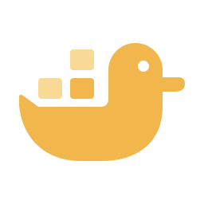

<p align="center"></p>

# DockDuck

A web GUI for the Docker Compose projects you already have. Up, down, start, stop and restart, live logs, a real terminal inside any container, compose and `.env` editing, registry login, and a view of every port in use, on your own machine or a server. One Go binary with the web UI inside. It works on your existing folders and compose files; it does not keep its own copy.

Docker contexts can be listed and switched, never created or removed.

**Documentation: <https://mnr73.github.io/dock-duck/>**

## Install

```sh
curl -fsSL https://mnr73.github.io/dock-duck/install.sh | sh
dockduck
```

Then open <http://127.0.0.1:9473>. The installer verifies the download against the release's SHA-256 checksums. To update, run the same command again, run `dockduck update`, or use **Settings → Updates**.

On a server, add `--service` to install a systemd unit, and see [running it on a server](https://mnr73.github.io/dock-duck/server/). Listening on a network address requires a password (`dockduck passwd`).

## What it does

- Finds compose projects in the folders you add, and shows their services, state, ports, CPU and memory
- `up` / `down` / `start` / `stop` / `restart` / `pull` / `build`, per project or per service, with output kept
- Live logs with search, filters and download; a PTY terminal (arrow keys, `vi`, resize) as the container user, root, UID 1000 or any user; sessions survive a reload
- Compose and `.env` editors with validation, atomic saves and backups; `.env` secrets hidden until revealed
- `docker login` / `logout` without secrets in process lists or logs
- Command palette (`Ctrl+K`), settings, light and dark themes, accent colour
- Login with a password, CSRF protection, brute-force lock, signed-out sessions close their terminals

## Build from source

Needs Go 1.26, Node 24 and pnpm 12.

```sh
make build            # web UI + server -> bin/dockduck
make lint test        # the CI gate
```

Development: `cd apps/server && go run ./cmd/dockduck --dev` and `cd apps/web && pnpm dev`. Project docs and the phase history live in [doc/](doc/README.md); contributor rules in [AGENTS.md](AGENTS.md).

## Releases

Pushing a tag `vX.Y.Z` runs the release workflow, which builds Linux and macOS binaries (amd64 and arm64), `checksums.txt` and a GitHub release. See [scripts/build-release.sh](scripts/build-release.sh).

## License

[MIT](LICENSE)
